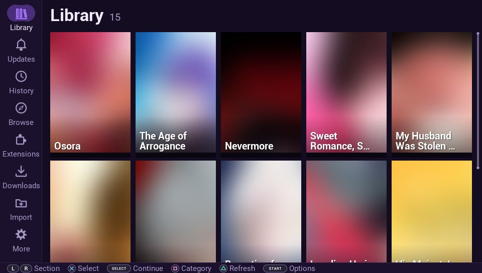
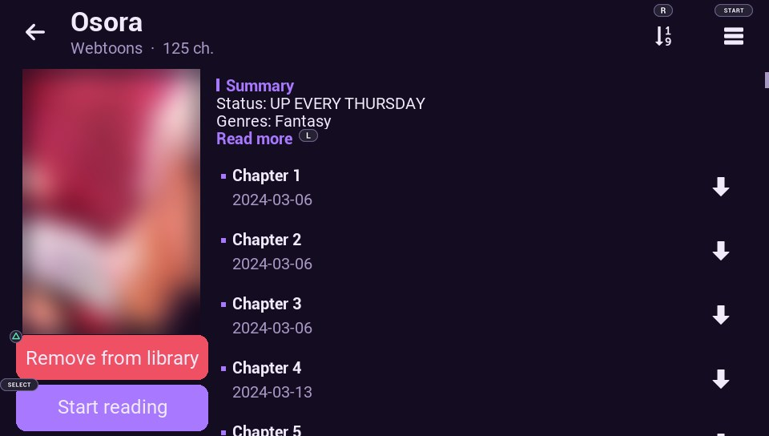
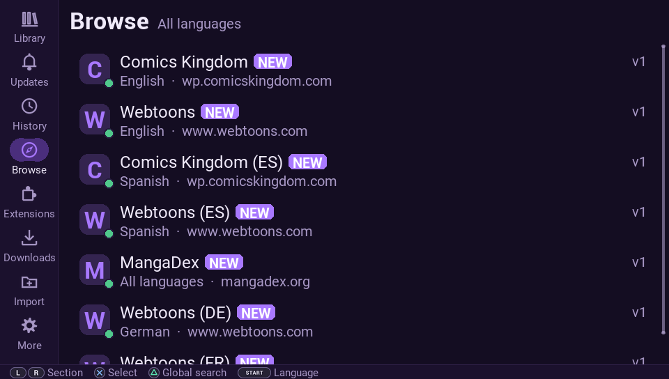

# Otakio

[](https://github.com/Garryth69/otakio/actions/workflows/ci.yml)
[](https://github.com/Garryth69/otakio/releases/latest)
[](LICENSE)

**Manga reader for the PS Vita**: library, reader, offline downloads, `.cbz`/`.zip` import and backups.
A fork of [NOBORU](https://github.com/Creckeryop/NOBORU), with features inspired by [Mihon](https://github.com/mihonapp/mihon).

Interface in English, Portuguese (Brazil), Spanish, French, German, Italian, Russian, Japanese and Chinese
(Simplified and Traditional).

| | |
|---|---|
|  |  |
|  |  |

<sub>Cover art is blurred on purpose: covers belong to their respective owners.</sub>

---

## Legal notice

- Otakio is **only a reader**. It does **not host, distribute or include** any manga, comics or images.
- The app **ships without content sources**. It only shows content from extension repositories that **the user chooses
  to add**, the same way Mihon/Tachiyomi work.
- This project has no affiliation with the websites, publishers or authors of the works.
- You are responsible for what you access. Support the authors: buy official releases and use official services
  (MANGA Plus, Webtoons, Comics Kingdom, local publishers, etc.).

## Installation

1. Download `Otakio-X.Y.Z.vpk` from [Releases](../../releases) and install it with **VitaShell** (the Vita needs
   HENkaku/Ensō). Each release also lists the file's SHA-256 if you want to verify the download.
2. Open Otakio. A short setup runs on the first launch. It covers the app language, the languages you read, adult
   content, reading direction, orientation, confirm button and theme.
3. On its last screen, **Install recommended sources** adds the
   [Otakio extension repository](https://github.com/Garryth69/otakio-extensions) and installs its own sources for the
   languages you picked. You can skip this and add any repository later.

Your data lives in `ux0:data/otakio/` and is **kept** when you install a new version on top.

## Extensions

Sources are small Lua files published in an *extension repository* (an `index.json` plus `.lua` files). The project's
repository is **[Garryth69/otakio-extensions](https://github.com/Garryth69/otakio-extensions)**, kept separate from the
app.

To add a repository on the Vita:

1. Open **Extensions** and press **Select**, or go to More → Extensions → Repositories.
2. Choose **Add repository** and type `user/repository`, e.g. `Garryth69/otakio-extensions`. A full URL to any
   `index.json` also works.
3. The **Available** tab lists the sources. **Start** switches language and **X** installs.

**Active languages** (in the setup, or More → Browse / Extensions) decide which languages appear as tabs in Extensions
and in Browse.

Each source has a status dot:
- **green** works;
- **yellow** is unstable;
- **red** doesn't work.

The status updates itself: installed sources are checked when the app starts and while you read. When the repository
publishes newer versions, the **Updates** tab tells you. A source that was removed from its repository keeps working,
but shows *Removed from repository* so you can uninstall it.

**Safety:**
- every file the official repository publishes is pinned by its SHA-256 in `index.json`, and a download that doesn't
  match is refused;
- extensions run in a sandbox: no file access, no app data, read-only settings;
- adding a third-party repository asks for confirmation.

**Manual extensions (optional):**
- copy a `.lua` extension to `ux0:data/otakio/extensions/manual/` and it loads on the next start, labelled *Manual*;
- it needs a header such as `-- @id my.source`, `-- @name My Source`, `-- @lang en`;
- the app never updates or replaces manual extensions.

Mihon-format repositories (Android APKs) can be added too. Their extensions don't run on the Vita: the app only reports
how many of those sources already have a Lua equivalent.

## App updates

Updates install **inside the app**. At startup, Otakio checks the latest version in [Releases](../../releases) and
asks whether to update. It then downloads the VPK, checks it, installs it with the system installer and restarts.
Your library and settings are kept.

- **More → About → Check for app updates at startup** turns the automatic check off.
- **More → About → Check for app updates** checks by hand at any time.
- If the install can't be done inside the app, the VPK is left in `ux0:/vpk/` to install with VitaShell.

## Features

- Library with categories, filters and new-chapter checks.
- Search inside each source (**Triangle** in a catalog) and global search.
- Offline downloads; the **Downloads** tab shows the queue and everything already downloaded.
- Import your own files: copy `.cbz`, `.zip` or image folders to `ux0:data/otakio/import/`.
- Backup and restore (More → Data): library, progress, history, categories, repositories and extensions.
- Import NOBORU data if `ux0:data/noboru/` exists.
- Save the current page as PNG, JPEG or WebP.
- Engine with native TLS 1.3 and WebP.
- No telemetry: nothing about you or your reading is sent anywhere.

## Troubleshooting

`ux0:data/otakio/log.txt` records extension loading, installs and errors. Attach it when you open an
[issue](../../issues).

## Development

Layout:

| Folder | Contents |
|---|---|
| `source/` | the app (Lua) + `eboot.bin` (engine) + `sce_sys/` (icon and LiveArea) |
| `engine/` | patches and script to rebuild the lpp-vita engine (see `docs/ENGINE_REBUILD.md`) |
| `tools/` | VPK builder, extension catalog generator, source tester and Vita simulator |
| `repo/` | **not part of this repository**: a clone of the extension repository |

Commands (Python 3 + `pip install lupa pillow`):

| Command | What it does |
|---|---|
| `python tools/build_vpk.py --name Otakio-1.0.vpk` | checks the Lua syntax and builds the release VPK (no extensions) |
| `python tools/build_vpk.py --with-catalog` | test VPK with the catalog from `source/repo/` bundled |
| `python tools/tests/sim.py <scenario> [--online] [--shots 100,200]` | runs the whole app on a simulated Vita and takes screenshots |
| `python tools/run_lua.py tools/tests/test_core.lua` | JSON, HTML and serialization tests |
| `python tools/gen_assets.py`, `python tools/gen_buttons.py` | generate the icons, logo, LiveArea and button glyphs |

To work on extensions, clone the extension repository into `repo/`:

```
git clone https://github.com/Garryth69/otakio-extensions repo
```

Then:

| Command | What it does |
|---|---|
| `python tools/gen_repo.py --kei <dir> --noboru <dir> [...] [--probe]` | builds the `repo/` catalog from keiyoushi themes, NOBORU parsers and the native extensions in `repo/native/` |
| `python tools/probe_sources.py [--ids file]` | tests sources live and writes `repo/health.json` |
| `python tools/prune_repo.py --kei <dir>` | follows keiyoushi removals and domain changes, and drops sources dead for 180+ days |
| `python tools/trace_source.py <id>` | prints every HTTP request an extension makes |

### Releasing a new version

1. Bump `VERSION`/`VERSION_NAME` in `source/assets/libs/config.lua`: the only place the version lives
   (`build_vpk.py` derives the `param.sfo` `APP_VER` from it).
2. Add a section for the version to [CHANGELOG.md](CHANGELOG.md).
3. Tag and push: `git tag vX.Y.Z && git push origin vX.Y.Z`. The release workflow builds the VPK and publishes the
   release with the changelog section as its notes. Manual alternative: `python tools/build_vpk.py`, then
   `gh release create vX.Y.Z build/Otakio-X.Y.Z.vpk`.

The app compares the latest release tag with its own version and offers to download the attached `.vpk`.

## Contributing

Bug reports, source fixes, new sources and translations are welcome: see [CONTRIBUTING.md](CONTRIBUTING.md).
Security problems: please report them privately, as described in [SECURITY.md](SECURITY.md).

## License

**GPLv3** ([LICENSE](LICENSE)), the same license as NOBORU, which Otakio was forked from. Anyone distributing the VPK must
also make the source code available, including the engine changes.

**Engine source:** `eboot.bin` is lpp-vita with Otakio's changes (TLS 1.3, WebP, image conversion). The changes are in
[`engine/patches/`](engine/patches) and, as commits, in the fork
[Garryth69/lpp-vita](https://github.com/Garryth69/lpp-vita) (branch `otakio`, see its `BUILDING.md`).

The theme engines in `source/assets/libs/engines.lua`, `engines_extra.lua` and `engines_intl.lua` adapt to Lua the theme
logic of [keiyoushi/extensions-source](https://github.com/keiyoushi/extensions-source), licensed under the
[Apache License 2.0](https://www.apache.org/licenses/LICENSE-2.0).

## Credits

- **Author:** Garryth69, with AI assistance (Claude, by Anthropic).
- **NOBORU** by [Creckeryop](https://github.com/Creckeryop): the original reader and engine fork.
- **Engine:** [lpp-vita](https://github.com/Rinnegatamante/lpp-vita) (Rinnegatamante), VitaSDK, vita2d (xerpi),
  LuaJIT, curl, OpenSSL, libpng, libjpeg and libwebp.
- **Source themes:** the [Mihon](https://github.com/mihonapp/mihon) community and [keiyoushi](https://github.com/keiyoushi).
- **Logo title font:** [Fredoka](https://github.com/hafontia/Fredoka-One), SIL Open Font License 1.1.
- Full list of components and licenses: [NOTICE.md](NOTICE.md).
- **Original NOBORU translations:** SamuEDL, theHeroGAC, Rinnegatamante, Samilop Iter, lukrynka and rutantan.
